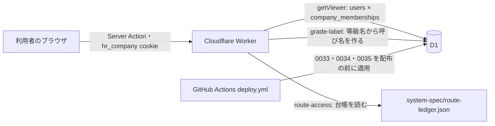

# アーキテクチャ: 2026-10 の改善要望

- feature: `feature-improvement-requests-2026-10`
- beads: `hr-wcv`（この文書は `hr-wcv.2` / SYS-IR-P02 の成果物）

## Architecture overview

11項目の改善要望と互換性の1件（範囲 S1〜S14・受入 A1〜A13。番号・担当・証跡は [仕様メモ](../specs/improvement-requests-2026-10.md) の照合表）を、次の7つの設計で受け止める。何を決めたかは [製品仕様 §28](../docs/product/spec.md)、なぜそうしたかは [設計判断](#設計判断) と [design-decisions.md](../docs/product/design-decisions.md) の DD-004〜DD-008 が正本。

1. 等級の呼び名を作る共通の関数（`src/lib/domain/grade-label.ts`）
2. 所属の表 `company_memberships` と、cookie `hr_company` で選ぶ会社（D-004）
3. ルート台帳 `system-spec/route-ledger.json` の権限の定義と、それを読む `src/lib/route-access.ts`（D-007）
4. Pointer Events の長押しドラッグとキーボードの共通 hook、並び全体の保存と id の集まりの照合による 409（D-005）
5. 表・役割のタブ・スマホのカードを1つの部品で出す権限一覧と、ポインター・フォーカス・タップで出る説明（D-006）
6. 等級と確定点数を返すかを、サーバーが役割から決める読み出し
7. 提出状況の集計と、設定不足の表示の型（何が足りない・どう直す・直す画面へのリンク）

## Context and drivers

- Business/technical context: 等級の呼び名が英語の区分名（Beginner など）・カタカナ・等級名で混在していた。権限は nav・layout・page・actions・API・台帳の6か所に別々に書かれ、台帳の `accessClass` はどの判定からも読まれていなかった。1人1社の前提（`users.company_id`）で、同じ人が2社目に入れなかった。提出状況・設定不足・並べ替え・選択肢・余白に、使いにくさの報告があった。アプリは Next.js 16.3.8（App Router）を OpenNext で Cloudflare Workers に載せ、データは D1 に置く。
- Quality attribute priorities: 1 位は権限と会社の境界（所属していない会社・権限のない役割に1行も見せず、1行も書かせない）。2 位は表示の一貫（等級の呼び名は1つの関数から作る）。3 位は既存データの保全（移行は冪等で、書き換え前の値を残す）。4 位は操作のしやすさ（並べ替え・選択肢・余白・設定不足の直し方）。配色とテーマは変えない。
- Constraints: 新しい依存を足さない（ドラッグは Pointer Events で自作）。役割は4つのまま。`pointGroup` は配点の表と結びつける鍵なので値を変えない。Workers の実行ファイルは圧縮後 3,072 KiB まで。D1 の batch は1回のトランザクション。保存は §27 の `runAction` と `refresh()` を通す。

## Goals and non-goals

- Goals: G6〜G15（[要件定義](../system-spec/00-requirements-definition.md)）。等級の呼び名を全画面で会社の等級名にそろえる。権限の定義を台帳の1つにする。複数の会社に所属できる。一覧に等級と確定点数を出し、見せる役割をサーバーで絞る。提出状況・設定不足・並べ替え・選択肢・余白を直す。
- Non-goals: 役割の種類の追加（システム開発者の役割は作らない）。等級名の変更権限を除く、役割ごとの権限の中身の変更。即時配信（WebSocket 等の push）とオフライン編集。配色の変更（DD-003）。

## System context and boundaries

- Users/external systems: 4つの役割（SUPER_ADMIN・COMPANY_ADMIN・MANAGER・EMPLOYEE）の利用者が、PC・スマホ・タブレットのブラウザから使う。画面の外の相手は Claude Code（Bearer の鍵）、Better Auth、配布を行う GitHub Actions で、この機能では形を変えない。
- Trust/deployment/data boundaries: 会社の境界は「選んでいる所属の `company_id`」。cookie `hr_company` は希望を伝えるだけで、サーバーが所属の表で確かめてから使う（全体管理者は全社から選べる）。他社の行は今までどおり 404。点数は、サーバーが役割で落としてから画面に渡す。
- Context diagram:



## Container and component view

責務と境界は [層分け](#層分け)、配置は [主要ファイル](#主要ファイル)、範囲ごとの置き場所は [S1〜S14 の置き場所](#s1s14-の置き場所) を参照。台帳（JSON）はビルド時に Worker へ取り込まれ、実行中に書き換えない。

## Cross-cutting contracts

- Identity/access: ログインは Better Auth のセッション。`getViewer` が「選んでいる所属」から `companyId`・`role`・`gradeId`・`managerId` を作る。画面の入口は `requireRoute(path)`、サーバー処理は `runAction({ operation })` で、どちらも最低の役割を台帳から引く。等級名の変更は COMPANY_ADMIN 以上（全体管理者と自社の会社管理者）に限る。
- Errors/resilience: 並び全体の保存で id の集まりが合わないとき、所属の追加で同じ会社に同じメールがあるとき、等級名の同時保存は 409。所属していない会社への切り替えは 403。未知の操作 id は 403（fail-closed）。
- Observability/audit: 所属の追加・削除と等級名の変更は `constitution_events`（監査ジャーナル）に本体と同じ batch で残す。移行 0034・0035 の書き換え前の値は `display_name_rewrites` に残す。
- Configuration/secrets: 新しい設定・秘密の値は無い。cookie `hr_company` は既存のまま（httpOnly・lax・secure・30日）。
- Compatibility/versioning: `users` の会社ごとの列（company_id・role・grade_id・office_id・manager_id）は「元の所属の写し」として残し、元の所属を書く batch で一緒に書く。所属が1つの人は今と同じ動きになる。移行は前へ進める形（0033・0034・0035）。

## Subtype architecture

合成の対象は5種で、どれも該当する。

- Frontend: Frontend architecture（権限一覧の部品・説明・並べ替えの hook・選択肢・段組み）
- Backend: Backend architecture（台帳を読む入口・所属の解決・点数の読み出し・提出状況・設定不足）
- Infrastructure: Infrastructure architecture（移行の適用と配布の順序）
- Data: Data architecture（所属の表・記録用の表・既定の等級名）
- Security: Security architecture（会社の境界・点数の可視範囲・等級名の変更権限）

### Frontend architecture

#### Rendering and application pattern

- Pattern: App Router のサーバー描画。権限一覧・説明・並べ替え・モーダルは Client Component。
- Framework/runtime and selection rationale: Next.js 16.3.8・React 19.2。ドラッグは Pointer Events（`pointerdown`・`pointermove`・`pointerup`・`pointercancel` と `setPointerCapture`）で自作し、ライブラリを足さない（D-005）。モーダルは HTML の `dialog` の `showModal()`。
- Browser/device support: PC・スマホ・タブレット。4つの幅（375・768・1280・1600px）で同じ振る舞い。

#### Routes, screens and navigation

- Route/screen map: 全47画面の正本は `system-spec/route-ledger.json`。新しく `/system/permissions`（権限一覧、`superStatic`）を足す。
- Authentication guard/deep link/history: 入口は `requireRoute(path)`。layout も同じ関数で、上の階層のパス（`/admin` など）を渡す。

#### Component and design-system boundaries

- Component hierarchy: `PermissionMatrix`（表・タブ・カード）を、権限一覧のページとモーダル（`PermissionDialog`）で共用する。説明は `InfoTip`。並べ替えは `useLongPressReorder` と `ReorderList`。設定不足は `SetupGapList`。提出状況は `SubmissionStatusTable`。
- Design tokens/reusable primitives: 色はテーマ契約の値だけを使い、新しい色を足さない。段組みは既存の `.grid-2` 系の共通クラスで作り、`main` に個別の最大幅を書かない。
- Accessibility standard: WCAG 2.2 AA。ドラッグには単一ポインターの代替（矢印のボタン）とキーボードを用意する（SC 2.5.7）。説明は消せる・載せたまま読める・消えない（SC 1.4.13）。可否は記号と言葉で示す。

#### State and data flow

- Local/server/global state ownership: 一覧・権限・点数・提出状況はサーバーが描いた画面が正本。部品が持つのは並べ替え中の並び・開閉・選んだタブだけ。『役割ごとにできること』の開閉は localStorage に覚え、読めないときは閉じた状態で動く。
- Fetch/cache/invalidation/optimistic update: 並べ替えの保存は `useSaveAction` で並び全体を送り、成功したら `refresh()` の画面に置き換える。409 のときは元の並びに戻し、再読み込みを頼む。
- Form/validation/error presentation: 選択肢の重複は保存のときサーバーの zod で断り、どの値が重なっているかを文で返す。
- 人の一覧（追加要望B、2026-10-14）: 3つの一覧はサーバーが一度に返した行を `PeopleList` が手元で探して並べ替える（DD-011）。検索語と並びの正本は URL で、`useSearchParams` が変わったら `parsePeopleView` で読み直す（移動・履歴の復元で古い server props に戻らない）。書き戻しは `syncPeopleUrl` の1か所で、入力中は300ms待ち、入力欄からフォーカスが移るときは待たずに確定する。
- マスターの編集（共通化レビュー、2026-10-14）: 4つの編集部品は保存・並べ替え・削除の送信と結果の表示を `useMasterAction(kind)` から受け取る。等級ごとの下書きは `key={grade.id}` で部品ごと作り直し、別の等級へ持ち越さない（`e2e/master-editing-scope.spec.ts`）。

#### Backend integration

- API client/generated types/versioning: 画面は `src/actions` を直接呼ぶ。台帳の型は `src/lib/route-access.ts` が JSON から作る。
- Auth/session/CSRF/CORS: 既存のまま（Cookie・送信元の二重検査）。
- Offline/retry/timeout: 自動で送り直さない。

#### Performance and observability

- Bundle/render/Core Web Vitals budgets: 台帳の取り込みで Worker の実行ファイルが増える分は数十 KiB に収まる。`check:bundle-size` で確かめる。点数は一覧の全員分を1回の問い合わせで取る。
- Client logs/metrics/traces and privacy: 並べ替えの保存は既存の `/api/usage` に `/actions/{resource}` で記録する。点数を記録に載せない。

#### Frontend verification

- Unit/component/visual/e2e/accessibility: [テスト](#テスト) の `useLongPressReorder`・`PermissionMatrix`・`InfoTip`・`FormAnswer` の単体試験と、`e2e/improvement-requests-2026-10.spec.ts`（4幅の撮影・権限一覧・並べ替え・選択肢）。

### Backend architecture

#### Runtime and architecture pattern

- Runtime/framework/version: Cloudflare Workers、Next.js 16.3.8 のサーバーアクション、Drizzle ORM 0.45、zod 4、Better Auth 1.6。
- Pattern: 判定は「台帳を読む入口」（`requireRoute`・`runAction({ operation })`）にまとめ、ページと処理は役割の名前を書かない。表示の文字列は `src/lib/domain` の純粋な関数が作る。
- Selection rationale and rejected alternatives: 権限は台帳に足す（D-007。DB の表と TS のモジュールは採らない）。所属は自前の表と cookie（D-004。Better Auth の organization plugin と URL に会社を入れる案は採らない）。

#### Domain and module boundaries

- Bounded contexts/modules: `grade-label`（呼び名）、`route-access`（台帳を読む）、`memberships`（所属の読み書き）、`score-visibility`（点数の可視範囲と読み出し）、`submission-status`（提出状況）、`setup-gaps`（設定不足の型）、`reorder`（並びの計算と照合）。
- Dependency direction: 画面 → `src/actions` → `src/lib`（入口・読み書き）→ `src/lib/domain`（純粋な関数）・`src/db`。`src/lib/domain` は DB も画面も知らない。
- Public/internal interfaces: 新しい公開の入口はサーバーアクションだけ（所属の追加・削除、会社の切り替えの拡張、並べ替えの保存）。Route Handler は増やさない。

#### API and integration contracts

- Contract style/source of truth: サーバーアクションの入力は zod。操作 id と最低の役割は台帳。
- Request/response/error schemas: 成功は `{ ok: true, message, ...data }`、失敗は `{ ok: false, message }`（§27 のまま）。
- Versioning/compatibility/deprecation: 並べ替えの向き（up・down・top・bottom）を送る既存の形は残し、並び全体を送る形を足す。

#### Data access and consistency

- Store/ownership/ORM/query boundaries: 所属の表は `src/lib/memberships.ts` だけが書く。読み出しは `users` と `company_memberships` を結合し、会社・役割・等級・上司は所属の値を使う。
- Transactions/idempotency/concurrency: 所属の追加と元の所属の写しは1回の batch。並べ替えは id の集まりを照合してから `display_order` を1から振り直す batch。等級名の変更は既存の `writeMasterBatch`（同時保存は 409）。
- 行動指針の割り当て（追加要望C、2026-10-14）: 割り当てか使用中かどうかを変える等級の保存は、判定に使った会社全体の割り当て（id・並び順・使用中・セット）を `writeGradeAssignmentBatch`（`src/lib/masters/grade-assignment-guard.ts`）が本体・監査と同じ batch の先頭で照合する。食い違えば CASE の失敗枝の `abs(INT64_MIN)` が integer overflow を起こして batch 全体を戻し、409（再読み込みを頼む）にする。等級名だけの保存と他社の保存は照合しない（`src/lib/masters/master-concurrent-save.integration.test.ts`）。
- Migration/backfill: 0033（所属の表と既存の利用者の所属）・0034（等級名の一律の書き換え）・0035（移行の予行で見つかった書き換えの漏れの直し）。詳しくは [Data architecture](#data-architecture)。

#### Reliability and operations

- Timeouts/retry/circuit/queue/background work: 背景の処理は増やさない。
- Rate limit/quota/backpressure: 既存のまま。
- Logs/metrics/traces/alerts: 監査ジャーナルに所属と等級名の変更を残す。

#### Backend verification

- Unit/contract/integration/load/failure tests: [テスト](#テスト) の `permissions-contract`・`memberships.integration`・`grade-names.integration`・`score-visibility`・`reorder`・`submission-status`・`setup-gaps-links`。

### Infrastructure architecture

#### Topology and environments

- Environments and promotion: ローカル（`wrangler dev` と preview）→ main への merge → `deploy.yml` が本番へ。
- Runtime/hosting/network: 変更なし（Workers と D1）。

#### Compute, storage and integration services

- Compute/runtime/scaling: 変更なし。
- Datastore/cache/object/queue/search: D1 に表を2つ足す（`company_memberships`・`display_name_rewrites`）。

#### Delivery and configuration

- IaC/build/deploy pipeline: `deploy.yml` の `migration_plan` が未適用の移行を数え、pending のときだけ `db:migrate:remote` を配布の前に実行する。0033 → 0034 → 0035 の順。
- Configuration/secrets/feature flags: 変更なし。

#### Reliability and recovery

- SLO/backups/restore/disaster recovery: 移行の前に `deploy.yml` が D1 を書き出して保管する（14日）。
- Rollback/failover/incident operation: [Delivery, migration and rollback](#delivery-migration-and-rollback)。

#### Infrastructure verification

- Policy/provisioning/restore/rollout tests: 移行のリハーサル（ローカルの D1 に2回流して差分0、戻し方の SQL で元の値に戻ることを確かめる。P08）。

### Data architecture

#### Domain and logical model

- Entities/relationships: 利用者（users）1 —— 多 所属（company_memberships）多 —— 1 会社（companies）。所属は役割・等級・事業所・上司・社員番号・部署・入社日・人物メモを持つ。上司は同じ会社に有効な所属を持つ利用者（`manager_id` は users.id を指し、同じ会社に所属があるかはアプリで確かめる）。
- Ownership/source of truth: 会社ごとの値（9列）の正本は所属の表。`users` の会社ごとの列は元の所属（有効な所属のうち一番古いもの）の写しで、アプリは読まない（戻すときのためだけに書く）。氏名・メール・利用中か・資格情報は利用者全体の値で `users` が正本。
- Invariants/constraints: 利用者と会社の組は一意（`uq_membership_user_company`）。全体管理者は所属を持たない。同じ会社に同じメールの利用者は1人（メールはシステム全体で一意のまま）。

#### Physical data design

- Store/schema/indexes: 次の2つの表を足す。

```sql
-- 0033: 所属の表
CREATE TABLE IF NOT EXISTS company_memberships (
  id text PRIMARY KEY NOT NULL,
  user_id text NOT NULL REFERENCES users(id) ON DELETE CASCADE,
  company_id text NOT NULL REFERENCES companies(id) ON DELETE CASCADE,
  role text NOT NULL DEFAULT 'EMPLOYEE' CHECK (role IN ('EMPLOYEE','MANAGER','COMPANY_ADMIN')),
  grade_id text,
  office_id text,
  manager_id text,
  employee_code text,
  department text,
  hired_at text,
  profile_note text,
  created_at integer NOT NULL,
  updated_at integer NOT NULL
);
CREATE UNIQUE INDEX IF NOT EXISTS uq_membership_user_company ON company_memberships (user_id, company_id);
CREATE INDEX IF NOT EXISTS idx_membership_company ON company_memberships (company_id);
INSERT OR IGNORE INTO company_memberships (id, user_id, company_id, role, grade_id, office_id, manager_id, employee_code, department, hired_at, profile_note, created_at, updated_at)
  SELECT 'mem_' || id, id, company_id, role, grade_id, office_id, manager_id, employee_code, department, hired_at, profile_note, created_at, updated_at
  FROM users WHERE company_id IS NOT NULL AND role IN ('EMPLOYEE','MANAGER','COMPANY_ADMIN');

-- 0034: 書き換え前の値の記録
CREATE TABLE IF NOT EXISTS display_name_rewrites (
  table_name text NOT NULL,
  row_id text NOT NULL,
  column_name text NOT NULL,
  old_value text NOT NULL,
  new_value text NOT NULL,
  company_id text,
  migration text NOT NULL,
  recorded_at integer NOT NULL,
  PRIMARY KEY (table_name, row_id, column_name)
);
```

- Partitioning/retention/archival: 記録の表は戻し方のために残し、消さない。
- Privacy/classification/encryption: 所属は個人に結び付く業務データ。点数は所属と同じ扱いで、見せる役割をサーバーで絞る。

#### Data movement and lifecycle

- Migration/backfill/versioning: 0034 は次の順に書く。各文は「まだ書き換えていない行」だけを対象にし、2回目は0行になる。
  1. 書き換える行の今の値を `display_name_rewrites` に `INSERT OR IGNORE` で残す（2回目は元の値を上書きしない）。
  2. `forms.title` のうち、移行前の等級名を含むもの（seed とアンケートの自動作成が付けた既定の題名）を `''`（表示のたびに作る既定）にする。
  3. `behavior_band_sets.name` のうち英語の区分名を含むものを `''`（割り当てた等級から作る）にする。
  4. `promotion_thresholds.label`・`promotion_requirements.transition_label`・`grade_point_rules.note` と、seed が入れた要件の本文の区分名を、既定の等級名へ置き換える。
  5. `grades.name` を `code` ごとの既定（beginner→等級1、regular→等級2、chief→等級3、am1→等級4-1、am2→等級4-2、manager1→等級5-1、manager2→等級5-2）に書き換える（`WHERE name <> 新しい値`）。`pointGroup` と `id` は変えない。
- Import/export/sync/reconciliation: CSV の取り込みは、移行前の等級名も新しい等級名も受け付ける（照合は生の名前と表示名の両方）。
- Deletion/retention/legal hold: 所属を外すときは、その会社の所属だけを消す。最後の所属を消すのは、今の利用者の削除と同じ扱い。

#### Data quality and operations

- Validation/quality checks: 元の所属の写しと所属の表の一致を契約テストで確かめる。英語の区分名の静的検査（`grade-label-static.test.ts`）。
- Backup/restore/RPO/RTO: `deploy.yml` の移行前の書き出し。戻し方は [Delivery, migration and rollback](#delivery-migration-and-rollback)。
- Lineage/audit/observability: `display_name_rewrites`（移行）と `constitution_events`（画面からの変更）。

#### Data verification

- Schema/migration/data-quality/restore tests: `src/db/memberships-migration.test.ts`・`src/db/grade-names-migration.test.ts`・`src/db/migration-corrections.test.ts`（2回流して差分0、戻し方の SQL で元に戻る）。

### Security architecture

#### Threat model and trust boundaries

- Assets/actors/trust boundaries: 資産は他社の利用者・点数・等級。境界は「選んでいる所属の会社」と「役割」。
- Threats/abuse cases/attack surface: cookie の書き換えによる他社への切り替え、送られた会社 id をそのまま使うこと、一般の社員の応答への点数の混入、他社の等級を指す要求、所属の追加でのメールの存在の漏えい、会社の管理者による他社にもいる人のパスワードの再発行（他社の乗っ取り）、会社ごとの値（人物メモ・社員番号）の他社への漏れ、別のタブで会社を切り替えたあとの古い画面からの書き込み。
- Security requirements and policy mapping: 要件定義の security 章（214行）の各項。

#### Identity, authentication and authorization

- User/service identity and authentication: Better Auth のまま。
- Session/token/MFA/key lifecycle: 変更なし。
- Authorization/tenant isolation/privilege model: cookie の会社は有効な所属で確かめ、無ければ一番古い有効な所属へ戻す（fail-closed）。全体管理者は停止中の会社を選べない。ページ・サーバー処理・Route Handler・一覧の点数は、どれも台帳の操作 id から最低の役割を引き、未知の id は 403。他社の等級・利用者を指す要求は 404。他社にも所属がある人の資格情報と利用者全体の値は全体管理者だけが変える。書き込みは画面を描いた会社（`__scope`）と照合し、違えば 409。

#### Data and application protection

- Data classification/encryption/key management: 変更なし。
- Input validation/output encoding/CSRF/CORS/SSRF: 既存のまま。並び全体の保存は、今の並びと同じ id の集まりだけを受け付ける。
- Secrets/configuration/dependency/supply-chain controls: 新しい依存は足さない。

#### Detection and response

- Audit/security logging/monitoring/alerting: 所属の追加・削除・等級名の変更を監査ジャーナルへ。
- Incident response/forensics/recovery: 変更なし。
- Privacy/compliance/retention/vulnerability management: 会社の管理者には、登録済みのメールについて今と同じ文面だけを返し、どの会社にいるかを知らせない。既存の利用者に所属を足すのは全体管理者だけで、初期パスワードを発行しない。

#### Security verification

- SAST/SCA/secret scan/authz/abuse/penetration tests: `permissions-contract.test.ts`・`memberships.integration.test.ts`・`grade-names.integration.test.ts`・`score-visibility.integration.test.ts`。結果は `eval-log/feature-improvement-requests-2026-10-security-review.json`（P09）。

## Architecture decisions

| ADR | Decision | Alternatives | Trade-on rationale | Consequences |
|---|---|---|---|---|
| D-004 | `opt-membership-cookie`: 自前の所属の表と cookie `hr_company` | Better Auth の organization plugin、URL に会社を入れる | 「設計判断」2・DD-004 | 良い点: 既存の cookie と getViewer を広げるだけ。悪い点: users の会社ごとの列を写しとして同期し続ける |
| D-005 | Pointer Events の長押しドラッグを自作 | HTML の Drag and Drop API、dnd-kit | 「設計判断」4・DD-005 | 良い点: 依存ゼロ・タッチで動く。悪い点: 読み上げとキーボードを自分で作る |
| D-006 | 1つの表と役割のタブ、スマホではカード | 表だけ、役割ごとの別ページ | 「設計判断」5・DD-006 | 同じ部品をページとモーダルで共用する |
| D-007 | 権限の定義を `route-ledger.json` に足す | DB の表、TS のモジュール | 「設計判断」3・DD-007 | 台帳を変えるとページ・処理・メニュー・権限一覧が同時に変わる。ずれは契約テストで落ちる |
| qa-v02 | 等級名の変更は全体管理者と会社の管理者。点数は KPI評価点と達成率の両方、確定済みだけ。既存の等級名は全社を一律に書き換え | 管理者が個別に直す、点数の写しの列を作る | 「設計判断」1・6・DD-008 | 移行は書き換え前の値を残し、戻せる |

## Delivery, migration and rollback

- Build/deploy topology: P05 の変更を main へ merge すると `deploy.yml` が動く。試験と build → D1 の書き出し → `migration_plan` で未適用を数え、pending なら `db:migrate:remote`（0033 → 0034 → 0035）→ `deploy:worker` → スモーク試験。D1 の操作と配布は同じ concurrency group で直列。
- Migration sequence: 0033（所属の表と既存の利用者の所属）→ 0034（記録の表と等級名の一律の書き換え）→ 0035（予行で見つかった漏れの直し: 等級名を変える前の名前で保存されたアンケートの既定の題名、seed が入れた KPI 項目の文の英語の区分名、昇格要件の本文の写しに残った区分名）。どれも冪等（`IF NOT EXISTS`・`INSERT OR IGNORE`・「まだ書き換えていない行」だけの `UPDATE`）。D1 は1ファイルを1回だけ適用するが、手で2回流しても結果は同じ。**本番に当てたあとは、移行のファイルを書き換えない**（直しは次の番号の移行で行う。予行で見つかった直しを 0033・0034 に入れず 0035 にしたのはこのため。DD-008）。本番の書き換えの前に、読み取り専用の問い合わせで対象の件数を数えて記録する。
- Rollback trigger/procedure: 自動のロールバックはしない。戻すときは新しい番号から順に流す。0035 は `drizzle/rollback/0035_migration_corrections_rollback.sql`、0034 は `drizzle/rollback/0034_grade_names_rollback.sql`（どちらも `display_name_rewrites` の `old_value` を元の行へ書き戻す `UPDATE`。今の値が移行の書いた値のままの行だけを戻し、移行のあとに会社が直した文は上書きしない）。0035 は 0034 のあとの値を前提に記録しているので、0034 も戻すときは 0035 を先に戻す。0033 は所属の表を消しても `users` の写しが残るので、アプリの版を戻せば元の動きになる。配布だけが失敗したら同じ workflow を再実行する。

## Risks and verification

- Risk/assumption: (1) `users` の会社ごとの9列を読む箇所（約98か所）を所属の結合へ移し漏らすと、2社目の利用者が一覧に出ないか、他社の値（等級名・人物メモ・上司）が出る。静的な検査（`memberships-contract.test.ts`）で、許可リストの外の直接の読み出しを0件に保つ。0033・0034 は `ALTER TABLE` を使わず、`IF NOT EXISTS`・`INSERT OR IGNORE`・条件付きの `UPDATE` だけで書き、2回流しても同じ結果にする。(2) 等級名を含む文の書き換えで、利用者が自分で書いた文を変えてしまう。移行は seed とアプリが作った既定の文だけを対象にし、記録の表に残す。(3) 長押しとスクロールの取り違え。移動の閾値と長押しの時間を試験で固定する。(4) 台帳の取り込みで実行ファイルが大きくなる。`check:bundle-size` で確かめる。
- Architecture fitness test: [テスト](#テスト) を `pnpm test` と CI で毎回検証する。
- Load/failure/security validation: preview で A1〜A12 を確かめる（P07）。セキュリティと a11y は P09。

## 層分け

| 層 | 受け持つこと | 置き場所 |
|---|---|---|
| 台帳 | ページの `accessClass`・ページ名・主な操作（操作 id・最低の役割・説明）・共通の操作 | `system-spec/route-ledger.json` |
| 台帳を読む関数 | 台帳から、ページの最低の役割・操作の最低の役割・権限一覧の行を作る。同じ情報を TS に持たない | `src/lib/route-access.ts` |
| 入口 | ページは `requireRoute(path)`、サーバー処理は `runAction({ operation })`。`getViewer` は選んでいる所属から作る | `src/lib/session.ts` / `src/lib/action.ts` |
| 所属 | 所属の読み書き・会社の切り替えの確認・元の所属の写し | `src/lib/memberships.ts` / `src/actions/memberships.ts` / `src/actions/company-scope.ts` |
| 呼び名 | 等級・区分・行動指針のセット・昇格の段階・アンケートの既定の題名 | `src/lib/domain/grade-label.ts` |
| 点数 | 見せる役割の判定と、確定済みの最新点数の一括の読み出し | `src/lib/score-visibility.ts` |
| 提出状況 | 対象者と回答から、提出済み・入力途中・未回答と件数を作る | `src/lib/domain/submission-status.ts` |
| 設定不足 | `{ what, how, href, linkLabel }` の型と、画面ごとのまとめ | `src/lib/domain/setup-gaps.ts` / `src/components/SetupGapList.tsx` |
| 並べ替え | 並びの計算・id の集まりの照合・`display_order` の振り直し、長押しとキーボードの hook | `src/lib/domain/reorder.ts` / `src/components/reorder/` |
| 権限一覧 | 表・役割のタブ・カード・説明・モーダル | `src/components/permissions/` / `src/app/system/permissions/page.tsx` |

## 設計判断

### 1. 等級の呼び名は保存せず、表示のたびに作る

`src/lib/domain/grade-label.ts` に次の関数を置き、画面・CSV の書き出し・アンケートの自動作成はここだけを使う。

- `DEFAULT_GRADE_NAMES`: `code` ごとの既定（beginner→等級1 … manager2→等級5-2）。
- `gradeLabel(grade | null)`: 等級名。無い・名前が空白だけなら「等級未設定」に1つにまとめる。呼び名「等級未設定」（`GRADE_UNSET_LABEL`）はこのファイルだけが持ち、人数の札（「等級未設定 3人」）もこの定数を使う（`src/lib/grade-label-static.test.ts` が確かめる）。
- `pointGroupLabel(pointGroup, grades)`: その区分の等級を `displayOrder` の順に「・」でつなぐ（例「等級4-1・等級4-2」）。区分名そのものは出さない。
- `bandSetLabel(set, grades)`: 割り当てた使用中の等級があれば「等級1・等級2向け」。無ければ保存した名前、それも空なら「基準セット{n}」。使用を止めた等級は新しいアンケートに出ないので数えない。
- `promotionStepLabel(from, to)`: 「等級1→等級2」。
- `targetGradesLabel(targetGrades, grades)`: 照合には生の値を使い、表示だけを変える。
- `formDisplayTitle(form, cycle, grade)`: `title` が空なら「{評価期間} {等級名} 実績アンケート」。空文字を「既定の題名」とする。

利用者が自分で付けた題名・自由記述は書き換えない。CSV の取り込みは生の名前と表示名の両方を受け付ける。

### 2. 所属は自前の表、会社は cookie で選び、サーバーで確かめる（D-004）

- **有効な所属**は「`companies.isActive = 1` かつテンプレートではない会社の所属」と定める。`getViewer`（全体管理者以外）は、cookie の会社に有効な所属があればそれを、無ければ有効な所属のうち一番古いものを使う。有効な所属が無ければ null（fail-closed）。
- `viewer.companyId`・`role`・`gradeId`・`officeId`・`managerId` は所属から作る。140か所の `viewer.companyId` はそのまま正しくなる。
- **会社ごとの列**は、所属の表が持つ9つ（`company_id`・`role`・`grade_id`・`office_id`・`manager_id`・`employee_code`・`department`・`hired_at`・`profile_note`）とする。社員番号・部署・入社日・人物メモも会社ごとの値なので、所属の表へ移す（0033 で元の所属へ写す）。`users` に残るのは氏名・メール・利用中か・資格情報だけで、会社ごとの列は元の所属の写し（戻すときのため）として残す。
- **会社ごとの列を `users` から直接読まない**。読むときは所属を会社の条件付きで結合する（`src/lib/memberships.ts` の `memberColumns`・`joinMembership(companyId)`）。`grades`・`offices` との結合には会社の条件（`grades.companyId = 所属の会社`）を必ず付ける。対象は会社ごとの9列を読む全ての箇所（調査時点で21ファイル・約98か所。`queries.ts` が44か所）。`memberships-contract.test.ts` が、許可リスト（元の所属の写しを書く `memberships.ts` と、全体管理者かを見る `session.ts` の1か所）の外で `users.<会社ごとの列>` を読む箇所が0件であることを確かめる。
- 書き込みは所属の行へ行い、その所属が元の所属なら同じ処理の batch の中で `users` の写しも書く（`writeMembership`）。
- 会社の切り替え（`switchCompanyScope`）は全ての役割に開き、選んだ会社に有効な所属があること（全体管理者は会社が有効でテンプレートでないこと）を確かめる。通らなければ 404。切り替えは所属が2つ以上ある人にも出す。
- **画面を描いた会社と書き込みの会社を照合する**。レイアウトが描いたときの会社の id を `CompanyScopeProvider` で配り、`useSaveAction`・`useReadAction` は送る値に `__scope` として添える。`runAction`・`runRead` は `__scope` を取り除いてから入力を検証し、`viewer.companyId` と違えば 409「別の画面で会社を切り替えたため、この画面の内容は古くなっています。再読み込みしてください。」を返す。切り替えたことは §27 のタブ間の知らせで他のタブへ伝える。
- **他社にもいる人を足すのは全体管理者だけ**。会社の管理者が、どこかに登録済みのメールで利用者を足そうとすると、今と同じ「このメールアドレスはすでに登録されています。」を返す（新しく漏れることは無い）。全体管理者は `/system/users` から、既存の利用者に所属を足す（`addMembership`。パスワードを変えず、初期パスワードも発行しない）。全体管理者のメールには所属を足せない（「この利用者には所属を足せません。」）。
- **資格情報と利用者全体の値は、他社にも所属がある人については全体管理者だけが変える**。会社の管理者は、その会社だけに所属する人なら今どおり氏名・メール・パスワードの再発行・利用の停止を扱える。他の会社にも所属がある人については、自社の所属の行（役割・等級・事業所・上司・社員番号・部署・入社日・人物メモ・所属を外す）だけを扱え、氏名・メール・パスワード・利用の停止を送ると 403。初期パスワードの控えも同じ規則で、その会社だけに所属する人の控えは会社の管理者が開け、他の会社にも所属がある人の控えは全体管理者だけが開ける（表は変えない）。
- **上司**は、同じ会社に有効な所属がある利用者だけを指せる。所属を外すとき、その会社でその人を上司にしている所属があれば 409 にし、部下の名前を示す。
- **会社の停止**は、その会社の所属を残したまま、有効な会社の所属が1つも残らない人だけを `isActive = 0` にする。元の所属の写しは、残る有効な所属のうち一番古いものへ書き換える。
- `company_memberships.role` には `CHECK (role IN ('EMPLOYEE','MANAGER','COMPANY_ADMIN'))` を付ける。全体管理者は所属を持たない。

### 3. 権限の定義は台帳だけに書き、コードは台帳を読む（D-007）

- 各ルートに `permissions: { summary, operations: [{ id, label, minRole, actions, description }] }` を足す。`actions` は `"actions/<file>.ts#<関数名>"` か `"api/<path>#<METHOD>"`。画面に結び付かない操作（会社の切り替え・外観の保存・検索など）は台帳の `sharedOperations` に置く。
- **ページの最低の役割と役割ごとの可否は、`accessClass` に明示する**（導かない）。各 `accessClass` に `access: { minRole, byRole: { <役割>: "full" | "conditional" | "none" }, condition?, conditionRef? }` を足す。`minRole` は、ログインの前に出すページ（`login`・`rootRouter`・`legacyRedirect`・`publicToken`）では `null`。契約テストは明示の値と `expectedByRole` の整合を確かめる: `none` ⇔ その役割は `anonymous` 以外のどの状態でも `200` にならない、`full`・`conditional` ⇒ どこかで `200`、`minRole` は `none` でない最も弱い役割。理由を示すだけの `200`（`outcomeMeaning` が理由の画面のもの）は「できる」に数えない。
- `conditional`（△）には、条件の言葉（`condition`。例「自分の部下だけ」）と、判定する関数の名前（`conditionRef`。例 `src/lib/session.ts#canViewEmployee`）を書く。契約テストはその関数が実在して export されていることを確かめる。
- **役割の判定はすべて操作 id で台帳を引く**。ページは `requireRoute(path)`、サーバー処理は `runAction({ operation })`・`runRead({ operation })`、Route Handler は `apiViewerFor(operationId)`、一覧の等級と点数は `can(viewer, "members.viewGradeScore")`、メニューは `navGroupsFor(role)`。いずれも `src/lib/route-access.ts` を通して台帳を読み、`route-access.ts` は役割の名前とページの対応を持たない。未知の操作 id は 403。
- メニューで役割により隠すページ（全体管理者に「自分の評価」を出さないなど）は、台帳のルートの `navHiddenFor` に書く。
- 契約テスト（`permissions-contract.test.ts`）が次を確かめる: 全ページの入口・全サーバー処理・全 Route Handler・全メニューの項目が台帳と双方向に合う。`runAction`・`runRead` の `role:`、`apiViewer("<役割>")`、`requireRole(` の直書きが0件。`=== "SUPER_ADMIN"` などの役割名の直接の比較は、許可リスト（ファイルと理由。台帳から導けない規則だけ）の外で0件。操作の `minRole` は、その操作を持つページの `minRole` 以上（`sharedOperations` は除く）。
- `saveMaster` は1つの操作 id（`masters.save`、COMPANY_ADMIN 以上）で、等級名を含む全ての kind を同じ役割で扱う。kind によって役割が変わる必要が出たら、そのときに処理を分ける。

### 4. 並べ替えは Pointer Events の自作 hook で、並び全体を保存する（D-005）

- `useLongPressReorder`: つまみの `pointerdown` から 350ms 動かさずに押し続けると持ち上げる。その前に 8px 以上動けばスクロールとみなして持ち上げない（マウスは押した時点で持ち上げる）。持ち上げたら `setPointerCapture` し、各行の位置から落とす位置を求めて示す。`pointerup` で置き、`pointercancel` と Esc で元に戻す。
- キーボード: つまみにフォーカスして Space で持ち上げ、↑↓で動かし、Space（または Enter）で置き、Esc で戻す。動かすたびに `aria-live` で「3番目に移動しました」と読み上げる。
- 矢印のボタン（先頭・上・下・末尾）は残す（単一ポインターの代替）。動かしたあとはフォーカスを同じ行の同じボタンへ戻し（端へ着いたら残る側のボタンへ）、`aria-live` で同じ言葉を読み上げる。
- タッチの細部: つまみだけに `touch-action: none`・`-webkit-touch-callout: none`・`user-select: none` を付け、行のほかの部分ではスクロールを妨げない。350ms を待つ間に `pointercancel` が来たら（ブラウザがスクロールを始めた）持ち上げずに終える。
- つまみは `button`。名前は「{n}番目『{行の名前}』を並べ替え」、使い方（「Space で持ち上げ、↑↓で動かし、Space で置きます。Esc で戻します。」）を `aria-describedby` で結ぶ。Space は `keydown` で `preventDefault` し、`click` の既定の動きと重ねない。つまみ・矢印のボタン・`InfoTip` は 24×24px 以上（SC 2.5.8）。
- 落とす位置の印は `--accent` の線、持ち上げた行は `--brand-soft` の面と `--line` の枠で示す（色はトークンの参照だけ。`globals.css` には配置の規則だけを足す）。
- 保存は並び全体（id の配列）を送る。サーバーは今の id の集まりと照合し、違えば 409。合えば `display_order` を1から振り直して1回の batch で書く。アンケートの設問と選択肢は、既存の全体保存（設問ごと書き直す）の中で並びを送る。

### 5. 権限一覧は1つの部品を、ページとモーダルで共用する（D-006）

- `PermissionMatrix` は台帳から作った行を受け取り、行はページ名、列は4つの役割。サイドバーの区分ごとに並べ、可否は記号（○・△・—）と言葉（できる・条件つき・できない）で示す。
- 役割のタブで1つの役割の列だけに絞れる。768px 未満ではページごとのカードに切り替える（表とカードは同じ行から作るので中身は同じ）。
- 役割のタブは `tablist`・`tab`・`tabpanel` で、←→で隣のタブへ移り、Home・End で端へ移る。
- 可否の記号の色は既存の `.chip` の系統（できる＝`--brand`、条件つき＝`--status-progress`、できない＝`--ink-muted`）を使い、色だけに頼らず言葉を並べる。
- `InfoTip` は `button`（名前は「{項目}の説明」）に `aria-describedby` で説明を結び、ポインターを載せる・フォーカス・タップのどれでも出す。タップで開け閉めするときは `aria-expanded` を切り替える。Esc で消え、説明の上にポインターを動かしても消えない。
- 利用者一覧と社員の一覧に、開け閉めできる『役割ごとにできること』の欄（`details`）を置き、開閉は localStorage に覚える。欄の中の『権限一覧を開く』で `PermissionDialog`（`dialog` の `showModal()`）を開き、閉じると元のボタンへフォーカスを戻す。

### 6. 等級と点数は、サーバーが役割で落としてから渡す

- 見せるかどうかは台帳の操作 `members.viewGradeScore`（MANAGER 以上）で決め、`can(viewer, "members.viewGradeScore")` で引く。
- `latestFinalizedScores(db, viewer, employeeIds)` は会社を引数で受けず、`viewer.companyId` に限る（全体管理者は、行ごとの所属の会社に限る）。全体管理者の利用者一覧は所属ごとに1行とし、等級と点数はその行の会社のものを出す。
- 問い合わせは `evaluations` の `status = 'finalized'` から、社員ごとに評価期間の開始日が最も新しい1件を `ROW_NUMBER()` で1回の問い合わせで取る。`totalScore`・`maxScore`・`requirementRate`・評価期間の名前を返す。
- 3つの一覧は `withGradeAndScore(viewer, rows)` を通す。見せない役割には、等級と点数のキーそのものを含めない。

### 7. 提出状況と設定不足は、構造を返して画面で並べる

- 提出状況: `summarizeSubmissions(targets, responses)` が、対象者ごとに `submitted`・`draft`・`none` と提出日時を返し、件数を数える。対象者は所属の表から求める（新しい表は作らない）。アンケートの一覧は件数、結果一覧とマネージャーの画面は全員の行と状態の絞り込み。
- 設定不足: `SetupGap = { what, how, href, linkLabel }`。準備の確認・制度の手順・409 の理由・アンケートの同期・古いサイクルの知らせは、文ではなくこの型を返す。リンクは `schemeStepPath` などのパスを作る関数から作る。`SetupGapList` は画面ごとにまとめ、初めの3件だけを見せて残りは開いて見る。

### 8. 変えないもの

- テーマの契約（[製品仕様](../docs/product/spec.md)「テーマ契約（全画面共通）」と DD-003）・`globals.css` の `brand_color_*`・テーマの契約テスト。
- 役割の種類（4つのまま。システム開発者の役割は作らない。『Claude Code連携（システム開発者専用）』は画面名の変更だけ）。
- `pointGroup` の値と、§27 の保存の経路。

## S1〜S14 の置き場所

| 範囲 | 置き場所 | 受け持つ task |
|---|---|---|
| S1 等級の呼び名の共通の関数と既定の等級名 | `src/lib/domain/grade-label.ts`、`data/grades.json`・`scripts/seed-data.mjs`・`scripts/seed-grade-schemes.mjs`・`drizzle/seed.sql`・`copyCompanyMasters` | P04・P05・P07 |
| S2 既存の等級名と表示名の一律の書き換え | `drizzle/migrations/0034_grade_display_names.sql`・`drizzle/migrations/0035_migration_corrections.sql`、`drizzle/rollback/0034_grade_names_rollback.sql`・`drizzle/rollback/0035_migration_corrections_rollback.sql`、`src/lib/import.ts`（回答の CSV は 0035 で直す前の設問名でも照合する） | P05・P08 |
| S3 等級名を変えられる役割 | `src/actions/masters.ts`（`saveMaster` の kind=`grade`・行動指針のセットの kind。台帳の操作 `masters.save`）、`src/lib/masters/apply-master-update.ts`（case `"grade"` の `ownGrade` で他社の等級は 404）、`src/app/admin/masters/page.tsx` | P04・P05・P09 |
| S4 権限の台帳 | `system-spec/route-ledger.json`、`src/lib/route-access.ts`、`src/lib/session.ts`、`src/lib/action.ts`、`src/lib/nav.ts` | P04・P05・P09 |
| S5 権限一覧のページとモーダル | `src/app/system/permissions/page.tsx`、`src/components/permissions/`、`src/app/system/users/page.tsx`・`src/app/admin/members/page.tsx` | P04・P05・P07 |
| S6 一覧の等級と点数 | `src/lib/score-visibility.ts`、`src/app/manager/members/page.tsx`・`src/app/admin/members/page.tsx`・`src/app/system/users/page.tsx` | P04・P05・P09 |
| S7 複数の会社への所属 | `drizzle/migrations/0033_company_memberships.sql`、`src/db/schema.ts`、`src/lib/memberships.ts`、`src/actions/memberships.ts`・`src/actions/company-scope.ts`・`src/actions/members.ts`・`src/actions/companies.ts`・`src/actions/credential-memos.ts`、`src/lib/session.ts`、会社ごとの列を読む全ての問い合わせ（`src/lib/queries.ts`・`export.ts`・`import.ts`・`evaluate.ts` ほか21ファイル）、`src/lib/use-refresh.ts`・`src/lib/action.ts`（`__scope` の照合） | P05・P08・P09 |
| S8 提出状況 | `src/lib/domain/submission-status.ts`、`src/components/SubmissionStatusTable.tsx`、`src/app/admin/forms/`・`src/app/manager/cycles/page.tsx` | P04・P05・P07 |
| S9 設定不足の示し方 | `src/lib/domain/setup-gaps.ts`、`src/components/SetupGapList.tsx`、`src/lib/setup-readiness.ts`・`src/lib/scheme-readiness.ts` | P04・P05・P07 |
| S10 画面名の変更 | `src/lib/domain/agent-keys.ts`（`AGENT_KEY_PAGE_LABEL`）、`system-spec/route-ledger.json` の `label`、`src/lib/nav.ts`（直書きをやめ、台帳の `label` を引く）、README・docs | P05・P12 |
| S11 並べ替え | `src/components/reorder/`、`src/lib/domain/reorder.ts`、`src/components/FormBuilder.tsx`、等級要件・昇格の編集部品 | P04・P05・P09 |
| S12 選択肢 | `src/components/FormAnswer.tsx`・`src/components/FormPreview.tsx`・`src/app/globals.css`（`.chip` の読み取り専用）、`src/actions/forms.ts`・`src/lib/form-build.ts` | P04・P05・P07 |
| S13 右側の余白 | 画面ごとに段組みを書き起こさず、共通の部品で補足を右へ寄せる: `SplitRow`（`.split-host`・`.split-row`）・`RecordForm` の `inline`・`SectionHeading` の `aside`・`CardHead` の `actions`・`CardRow` の `value`（`src/components/ui.tsx`・`src/components/RecordForm.tsx`）、`RecordList`（`@container record-list`。`src/app/globals.css`）、`FormActionList`（`src/app/me/MyDashboard.tsx`）、`CsvImport`、`CopyReminder` の `lead`（回答画面の URL の行の右端に連絡文のコピーを置く。中は `SplitRow`）。対象は14画面に閉じる。調査で選んだ7画面（`/admin/cycles`・`/admin/behavior`・`/forms`・`/forms/[id]`・`/admin/forms/[id]`・`/me`・`/system`）、同じ崩れ方をしていた4画面（`/admin/forms`・`/admin/forms/[id]/responses`・`/manager/cycles`・`/system/permissions`）、等級と点数を足した一覧の3画面（`/system/users`・`/admin/members`・`/manager/members`）。`/account/password` の `.narrow-form` は意図して絞っているので除く。共通の最大幅は変えない（[製品仕様 §28-9](../docs/product/spec.md)） | P05・P07 |
| S14 版と台帳 | `package.json`（Next 16.3.8）、`system-spec/route-ledger.json`（47画面） | P05・P13 |

## 主要ファイル

| 役割 | パス |
|---|---|
| 台帳 | `system-spec/route-ledger.json` |
| 台帳を読む関数 | `src/lib/route-access.ts` |
| 入口 | `src/lib/session.ts`（`getViewer`・`requireRoute`）/ `src/lib/action.ts`（`runAction({ operation })`） |
| 所属 | `src/lib/memberships.ts` / `src/actions/memberships.ts` / `src/actions/company-scope.ts` / `src/components/CompanyScopeSwitcher.tsx` |
| 呼び名 | `src/lib/domain/grade-label.ts` |
| 点数 | `src/lib/score-visibility.ts` |
| 提出状況 | `src/lib/domain/submission-status.ts` / `src/components/SubmissionStatusTable.tsx` |
| 設定不足 | `src/lib/domain/setup-gaps.ts` / `src/components/SetupGapList.tsx` |
| 並べ替え | `src/lib/domain/reorder.ts` / `src/components/reorder/useLongPressReorder.ts` / `src/components/reorder/ReorderList.tsx` |
| 権限一覧 | `src/components/permissions/PermissionMatrix.tsx` / `src/components/permissions/PermissionDialog.tsx` / `src/components/InfoTip.tsx` / `src/app/system/permissions/page.tsx` |
| 移行 | `drizzle/migrations/0033_company_memberships.sql` / `drizzle/migrations/0034_grade_display_names.sql` / `drizzle/migrations/0035_migration_corrections.sql` / `drizzle/rollback/0034_grade_names_rollback.sql` / `drizzle/rollback/0035_migration_corrections_rollback.sql` |

## テスト

| テスト | 固定すること | 受入 | task |
|---|---|---|---|
| `src/lib/domain/grade-label.test.ts` | 既定の等級名、区分・行動指針のセット・昇格の段階・アンケートの既定の題名の作り方、未設定の言い方 | A1 | P04・P06 |
| `src/lib/grade-label-static.test.ts` | `src` の画面の文字列に英語の区分名とカタカナの呼び名が無い（`pointGroup` の鍵としての使用は除く） | A1・A2 | P04・P06 |
| `src/actions/grade-names.integration.test.ts` | 等級名を変えると全ての表示が新しい名前になる。MANAGER・EMPLOYEE は 403、他社の等級 id は 404、A社では管理者でB社では一般の社員の人がB社を選んで変えると 403。どの場合も1行も書かない | A2・A3 | P04・P06・P09 |
| `src/lib/permissions-contract.test.ts` / `scripts/route-ledger.test.mjs` | 全ページの入口・全サーバー処理・全メニューが台帳と合う。台帳は47画面で、全ページに `permissions` がある | A3・A4・A13 | P04・P06・P09 |
| `src/components/permissions/PermissionMatrix.test.ts` | 表とカードが同じ行を出す。可否を記号と言葉で示す | A4 | P04・P06 |
| `src/lib/score-visibility.integration.test.ts` | 確定済みの最新だけを取る。EMPLOYEE には等級と点数のキーを含めない | A5 | P04・P06・P09 |
| `src/actions/memberships.integration.test.ts` | 2社目への所属、所属していない会社への切り替えの拒否、同じ会社の同じメールの拒否、全体管理者による既存の利用者への所属の追加でパスワードを変えないこと、会社の管理者は他社にもいる人のパスワード・利用の停止・控え・氏名・メールを扱えない（403）、会社ごとの列（人物メモ・社員番号など）が他社に出ないこと、停止中の会社の所属を選ばないこと、上司にしている部下が残る所属を外すと 409、`__scope` が違えば 409 | A6 | P04・P06・P09 |
| `src/db/memberships-migration.test.ts` / `src/db/grade-names-migration.test.ts` / `src/db/migration-corrections.test.ts` | 2回流して差分0。戻し方の SQL で元に戻る（0035 → 0034 の順） | A2・A6 | P05・P08 |
| `src/lib/domain/submission-status.test.ts` | 対象者全員に状態と件数が付く | A7 | P04・P06 |
| `src/lib/domain/setup-gaps-links.test.ts` | 設定不足の全件に何が・どう直すか・リンクがある | A8 | P04・P06 |
| `src/lib/domain/reorder.test.ts` / `src/components/reorder/useLongPressReorder.test.ts` | ポインター・タッチ・キーボードで同じ並び。id の集まりの違いは 409 | A10 | P04・P06・P09 |
| `src/components/FormAnswer.test.ts` / `src/lib/form-build.test.ts` | 選択肢の行のどこを押しても選べる。値の重複を断る | A11 | P04・P06 |
| `src/lib/memberships-contract.test.ts` | 許可リストの外で `users` の会社ごとの9列を直接読む箇所が0件。`grades`・`offices` との結合に会社の条件がある | A6 | P04・P06・P09 |
| `e2e/improvement-requests-2026-10.spec.ts` | 権限一覧の説明が Esc で消え、説明の上へポインターを動かしても消えない（A4）。長押しの並べ替え（タッチの機器の設定、A10）。S13 の14画面で、1280px と 1600px のとき、中身（文字の各行・入力欄・ボタン・画像。枠と背景は数えない）のある高さのうち、本文（`main` の内側）の右 40% に何も無い高さが 40% 以下（A12。枠は幅いっぱいでも中身が左に寄る #14 の形を捉えるため、最も右の端ではなく高さの割合で測る。表は行（`tr`）を1つの単位として見て、右の列に中身がある行の高さは空きと数えない） | A4・A10・A12 | P04・P07 |
| `pnpm test`・`pnpm test:coverage`・`pnpm check:docs` | 全ての試験が通り、`src/lib/domain/**` のカバレッジ 100%、文書の食い違いが0件 | A13 | P06・P10 |
